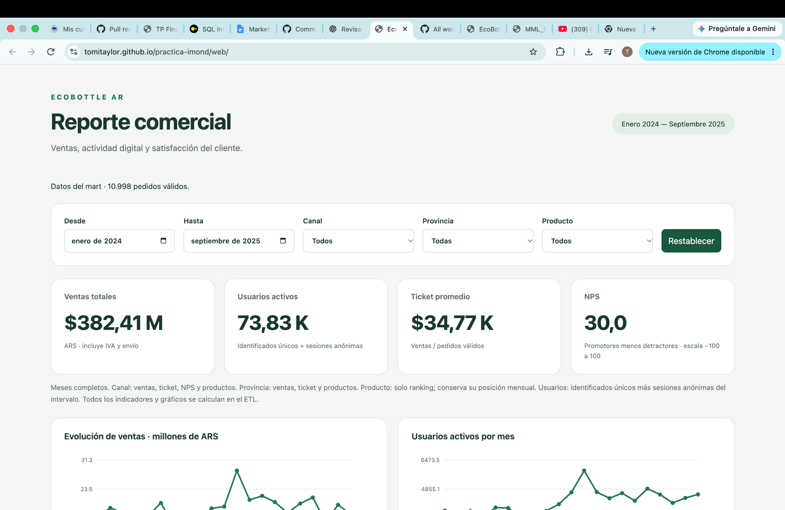
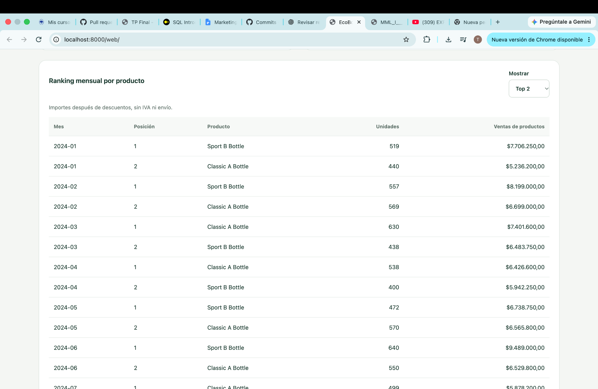

# EcoBottle AR — Reporte comercial

Trabajo práctico de Introducción al Marketing Online y los Negocios Digitales. Autor: Tomás Taylor.

El proyecto transforma los datos comerciales de EcoBottle AR en un modelo estrella y genera un tablero de ventas, actividad digital y satisfacción. Los datos son simulados y corresponden al período enero de 2024 a septiembre de 2025.

**[Abrir el tablero publicado](https://tomitaylor.github.io/practica-imond/web/)**

## Documentación

- [Diccionario de datos: tablas, grano, columnas, claves y dominios](docs/diccionario_datos.md).
- [Arquitectura, métricas, filtros y limitaciones](docs/arquitectura_tablero.md).
- [Consultas clave y resultados de referencia](docs/consultas_clave.md).
- [Hallazgos comerciales y propuestas](docs/hallazgos.md).
- [Modelo estrella generado por el ETL](dw/modelo_estrella.md).
- [Diagrama de las tablas de origen](assets/DER.png).
- [Consigna del profesor](https://docs.google.com/document/d/15RNP3FVqLjO4jzh80AAkK6mUR5DOLqPxLjQxqvdzrYg/edit?usp=sharing).

## Ejecución local

Se necesita Python compatible con la versión de DuckDB de `requirements.txt`, Git y acceso a una terminal. En macOS o Linux, desde una carpeta donde quieras clonar el proyecto:

```bash
git clone https://github.com/tomitaylor/practica-imond.git
cd practica-imond
python3 -m venv .venv
source .venv/bin/activate
pip install -r requirements.txt
python run_sql.py
python -m http.server 8000
```

Abrir [http://localhost:8000/web/](http://localhost:8000/web/). El servidor queda ejecutándose en esa terminal; se detiene con `Ctrl+C`. Para usar Git mientras está activo, abrir otra terminal en el proyecto.

En Windows, crear el entorno con `python -m venv .venv` y activarlo con `.venv\Scripts\activate.bat` en CMD o `.venv\Scripts\Activate.ps1` en PowerShell. El resto de los comandos es el mismo.

Si el repositorio y el entorno ya existen, activar `.venv` e instalar las dependencias solo si faltan o cambió `requirements.txt`. Ejecutar `python run_sql.py` cuando cambien los SQL o los datos. Los cambios de documentación no requieren reconstruir la base.

`run_sql.py` reconstruye `warehouse.duckdb`, ejecuta `sql/*.sql` en orden alfabético, muestra las consultas SELECT, regenera los CSV de `dw/` y escribe el diagrama. La base DuckDB queda fuera de Git; puede reproducirse con el mismo comando. Los archivos de `raw/` se conservan sin modificaciones.

Para explorar el resultado con la herramienta provista por el profesor:

```bash
python run_sql.py --ui
```

## Organización del proyecto

| Ruta o módulos | Función |
|---|---|
| `raw/` | Los 13 CSV de origen proporcionados por el profesor |
| `sql/1000_*.sql` a `sql/1090_*.sql` | Diez dimensiones, una por archivo |
| `sql/2000_*.sql` a `sql/2050_*.sql` | Seis hechos, uno por proceso |
| `sql/2900_periodos_reporte.sql` | Intervalos mensuales, opciones de filtros y vistas auxiliares |
| `sql/3000_*.sql` a `sql/3040_*.sql` | Marts de ventas, productos, actividad, NPS y gráficos |
| `sql/4000_*.sql` a `sql/4040_*.sql` | Consultas de revisión y KPIs |
| `sql/9000_validaciones.sql` | Conciliación entre origen, hechos y marts |
| `dw/` | Tablas exportadas y modelo generado; se versionan los marts necesarios para la web y el diagrama |
| `web/` | HTML, CSS y JavaScript del tablero |
| `docs/` | Diccionario, arquitectura, consultas y hallazgos |
| `assets/capturas/` | Capturas del tablero |
| `generator/` | Generador y controles originales del profesor; no hace falta regenerar el origen |

Se conserva el ejemplo resuelto de `dim_product` del profesor. La jerarquía de categorías se aplana dentro de esa dimensión. Las direcciones y provincias de las tiendas también se aplanan. Medio de pago, fuente de tráfico y dispositivo tienen dimensiones propias. Sus claves apuntan a un miembro desconocido cuando falta el dato. Las PK y FK del modelo están detalladas en el diccionario.

## Arquitectura y decisiones

El flujo es `raw → dimensiones y hechos → marts → tablero`. Los marts se construyen desde el modelo estrella. La web carga exclusivamente `dw/mart_*.csv` y selecciona las filas precalculadas que corresponden a los filtros.

Todos los indicadores se calculan en SQL. También se generan en el ETL los rankings, importes escalados, porcentajes de barras y SVG de las series. JavaScript carga los CSV, selecciona filas, aplica formato de presentación y muestra el contenido; no calcula medidas comerciales.

Los filtros trabajan con meses completos. Para los 21 meses disponibles se precalculan los 231 intervalos contiguos posibles. Así, usuarios distintos, ticket y NPS se resuelven para el intervalo exacto, sin sumar distintos mensuales ni promediar promedios.

## Definiciones y supuestos

| Indicador | Criterio |
|---|---|
| Ventas totales | Suma de `total_amount` de pedidos `PAID` o `FULFILLED`; incluye IVA y envío |
| Usuarios activos | Distintos de `visitor_key`: cliente identificado o identificador de sesión si es anónima |
| Ticket promedio | Ventas totales / cantidad de pedidos válidos de la misma selección |
| NPS | Promedio de valores 1, 0 y -1 para promotores, pasivos y detractores, multiplicado por 100 |
| Ventas por provincia | Provincia de la dirección de envío del pedido; en las compras en tienda corresponde a su dirección |
| Ranking mensual | Ventas por producto después de descuentos, sin IVA ni envío; puestos con `DENSE_RANK` |

Los hechos conservan todos los estados; los marts de ventas y productos excluyen pedidos creados, cancelados y reembolsados. Se usan miembros de clave -1 para cliente desconocido, dirección desconocida y tienda No aplica. No se descartan compras históricas de clientes inactivos.

Los filtros de fecha afectan todos los indicadores. Canal afecta ventas, ticket, NPS y productos; provincia afecta ventas, ticket y productos. Producto y Top N seleccionan filas del ranking, conservando el puesto original. No se atribuye provincia o producto a las respuestas NPS ni dimensiones comerciales a las sesiones web cuando el origen no permite hacerlo.

Una sesión anónima no equivale necesariamente a una persona diferente. La métrica sigue el sustituto por sesión indicado en la consigna. Sin pedidos, el ticket es nulo; sin respuestas, el NPS es nulo. Los importes están en ARS nominales y los horarios del origen corresponden a Argentina.

## Controles y valores de referencia

`9000_validaciones.sql` compara cantidades de origen y hechos y concilia ventas, productos, usuarios y NPS del intervalo completo. Leer el origen en estos controles no lo convierte en fuente del tablero.

Además, muestra una tabla de diez controles con una columna `inconsistencias`. Todas las filas deben dar **0**:

- Subtotal del pedido diferente de la suma de sus líneas.
- Total diferente de subtotal + IVA + envío.
- Pedidos sin líneas.
- Claves lógicas duplicadas en cada uno de los siete marts.

Los controles de importes abarcan todos los estados del pedido, no solo las ventas válidas. El control de subtotal compara pedidos que tienen líneas; el control siguiente detecta los que no tienen ninguna. En los marts se cuentan claves duplicadas, no la cantidad de copias adicionales. Las filas de distintos niveles de total o intervalos son legítimas y se distinguen por su clave completa.

Estos controles muestran resultados para revisar: no agregan restricciones físicas a los marts ni detienen automáticamente el proceso si aparece una inconsistencia. Si algún valor es mayor que cero, revisar los SQL antes de publicar los CSV.


| Medida | Enero 2024–septiembre 2025, sin otros filtros |
|---|---:|
| Pedidos válidos | 10.998 |
| Ventas con IVA y envío | $382.410.636,00 |
| Ticket promedio | $34.770,93 |
| Ventas de productos sin IVA ni envío | $309.891.600,00 |
| Usuarios activos según definición de la consigna | 73.828 |
| Respuestas NPS | 3.083 |
| NPS | 30,00 |

Se comprobaron en el tablero la selección enero de 2024 / ONLINE / Buenos Aires, Restablecer, Top 1, Top 2 y el filtro Classic A conservando sus posiciones. La selección de prueba devuelve 93 pedidos, ventas de $3.174.915,00, ticket de $34.138,87, 3.650 usuarios y NPS ONLINE de 27,27; usuarios y NPS respetan el alcance de filtros documentado.

## Capturas

Vista general del tablero publicado en GitHub Pages:



Ranking mensual Top 2, comprobado durante la ejecución local:



## Publicación y actualización

GitHub Pages está configurado para publicar desde `main`, carpeta `/ (root)`. La URL del tablero termina en `/web/`; las rutas relativas permiten cargar los CSV de `dw/` del mismo repositorio.

Cuando cambian los cálculos, ejecutar el ETL y revisar los resultados antes de guardar los cambios. Versionar los SQL, archivos web, documentación, los siete `dw/mart_*.csv` y `dw/modelo_estrella.md`. Usar commits descriptivos con Conventional Commits y ejecutar `git push origin main` desde la consola. La publicación se puede revisar en la pestaña Actions.

El tablero publicado usa los CSV versionados. GitHub Pages no ejecuta Python ni reconstruye el warehouse: los nuevos datos deben generarse localmente y subirse. No admite días individuales. Para períodos más extensos, la cantidad de intervalos y gráficos crece y habría que revisar esta estrategia.
